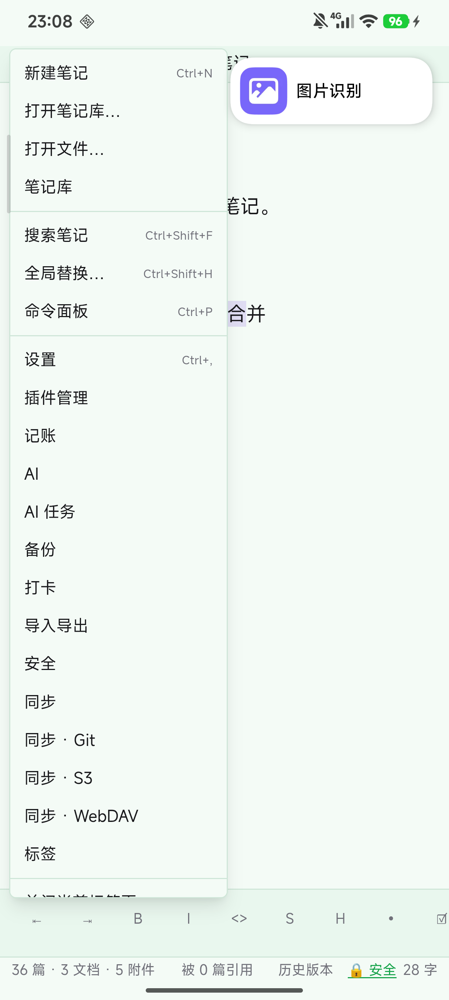
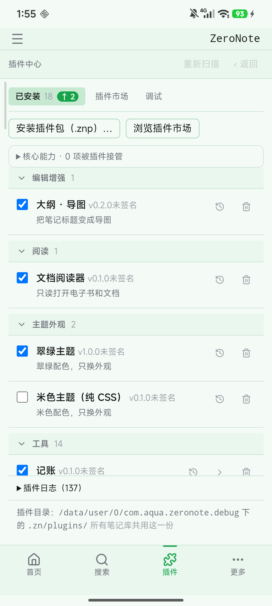

# ZeroNote 手机版使用手册

> 状态：**active** ｜最后核对：2026-10-30（rev173.258 · B3 插件中心 + 设置瘦身） ｜权威范围：手机版**普通用户**操作说明（不用讲原理，只讲怎么点）
>
> 面向第一次用的人写。术语都换成了日常说法：不叫「面板」叫「页面」，不叫「插件宿主」叫「功能」。
> 截图来自真机（ARIA 24069RA21C · Android 16），图里灰白色的卡片流就是你的笔记首页。

---

## 0 先说三件事

1. **笔记就是文件夹里的 `.md` 文件**。手机上的位置是 `内部存储/Documents/ZeroNote/`，用数据线接电脑就能看到，换手机把这个文件夹拷走就行。
2. **没有账号、没有官方云端**。写的东西默认只在这台手机上。想要多设备同步，可以装自带的同步插件，用你自己的网盘 / WebDAV / S3 / Git（在**插件中心**里点对应同步插件的「设置」配置）。
3. **写就自动存**。停手约 0.8 秒自动保存，右上角会显示「已保存」。

---

## 1 首页长这样

| 位置 | 是什么 |
|---|---|
| 顶部 ☰ | 打开左边抽屉（笔记库 / 文件夹 / 回收站） |
| 顶部中间 | 软件名「ZeroNote」 |
| 中间一叠卡片 | 你的笔记，**最新的在最上面**。每张写：修改时间 + 正文前几行 |
| 底部绿色 ＋ | 新建一条笔记（**长按**开环形快捷入口） |
| 底部四个图标 | **首页 / 搜索 / 插件 / 更多** —— 打开笔记时这一条会隐藏（让位给键盘上方工具栏） |
| 底部一行小字 | 「36 篇 · 3 文档 · 5 附件」——当前库里有多少笔记、文档、附件 |

点任意一张卡片 → 打开那篇笔记。

---

## 2 写一条笔记

1. 点底部的绿色 **＋**
2. 第一行就是**标题**（会自动变成文件名），换行后写正文
3. 写完不用保存，停手约 0.8 秒，右上角从「未保存」变成「已保存」

编辑器里能做的事：

| 位置 | 功能 |
|---|---|
| 右上「源码」 | 在「好看的样子」和「Markdown 原文」之间切换 |
| 底部一排 `⇤ ⇥ 📎 🔍 B I <> S H • ☑ ❝ {} 🔗 ▦ ―` | 缩进 / 取消缩进 / **插入附件** / **在正文里查找** / 粗体 / 斜体 / 代码 / 删除线 / 标题 / 无序列表 / 待办 / 引用 / 代码块 / 链接 / 表格 / 分隔线（左右滑动看全） |
| 左上 ☰ | 打开笔记库抽屉 |

> 底部工具栏是**手机专属**。桌面上没有，桌面用右键菜单。

---

## 3 长按 ＋：快捷入口

**按住绿色 ＋ 半秒**，会弹出一个小半圆，中间是 ＋、上方 5 个圆圈：

- **短按 ＋** = 新建笔记（和以前一样）
- **长按 ＋** = 打开这圈入口
- **5 个位置只有装了对应功能才会亮**。默认新装时都是空位；装了「记账」插件后第一格才会亮
- 点**空白处**或中间的 **×** 关闭

---

## 4 找笔记：抽屉与笔记库

点左上角 **☰** 打开左侧抽屉：

从上到下：

| 区域 | 用途 |
|---|---|
| 顶部齿轮 | 打开设置 |
| 「新建笔记 / 新建文件夹」 | 在当前文件夹里新建 |
| 文件夹列表（笔记 / 工作 / 灵感 / 文档 / 学习） | 点箭头展开收起 |
| 文件列表 | 点一下打开 |
| 文档分组 | PDF / EPUB / TXT 之类的文件，点开直接看 |
| 附件分组 | 图片 / 音视频 / 压缩包等，后面带数量 |
| 底部 🗑 回收站 | 看删掉的东西 |
| 最底「ZeroNote」 | 切换笔记库 |

### 换一个笔记库

点抽屉最底部的 **ZeroNote** → 弹出「打开其它文件夹…」：

一个文件夹 = 一个笔记库。可以按项目分开放。

---

## 5 改名 / 删除 / 找回

**长按任意一张卡片**（或用卡片右上角的 ⋯）：

| 菜单项 | 效果 |
|---|---|
| 打开 | 进编辑 |
| 重命名… | 改文件名 |
| 删除（回收站） | 删掉，但**能找回** |
| 彻底删除… | 真删，撤不回来 |

删掉的笔记会进**回收站**（抽屉底部）：

点「恢复」放回去，点「彻底删除」永久抹掉。

---

## 6 长按是两个不同的菜单

**长按正文**：浮出一条横条，四个动作 —— **复制 / 剪切 / 粘贴 / 全选**。

**长按左上角的 ☰**：打开主菜单，和电脑上右键同源 ——

新建笔记 · 打开笔记库… · 打开文件… · 搜索笔记 · 全局替换… · 命令面板 · 首选项 → 设置 · 插件中心，
以及**已装插件的入口**（记账 / AI / 备份 / 打卡 / 导入导出 / 安全 / 同步 · Git / S3 / WebDAV / 标签 …）。

> 📎 **插入附件** 和 🔍 **查找** 就在键盘上方那条工具栏里（缩进按钮后面两个）；
> 长按 ☰ 的主菜单里也有同样的两项。

---

## 7 把笔记变成导图

用「# 标题 + 列表」写的内容，可以一键变成思维导图：

1. 打开笔记，点**标题 / 列表组左边**那个 **❖**
2. 导图在标签里打开（可以把它拖出来变成独立窗口），能缩放、拖动
3. 关掉导图标签 / 窗口，回到普通编辑

> 导图会读你笔记里的大小标题和列表层级。层级越清楚，导图越好看。

---

## 8 记账（要先装插件）

记账不是预装的：**底栏 🧩 插件 → 插件市场 → 记账 → 安装**。装好后**长按 ☰ → 记账**（或长按 ＋ 点第一格）。

| 区域 | 用途 |
|---|---|
| 顶部「同步通知」 | 把手机通知里的支付记录抓进来（微信 / 支付宝） |
| 「检查权限」/「打开授权页」 | 第一次用要开「通知使用权」 |
| 本月支出 / 收入 / 结余 | 自动算好 |
| 列表 | 每一笔：时间 · 商户 · 金额 · 分类 |
| 点分类名 | 改成别的分类（下次同商户自动记住） |
| 底部「手动记一笔」 | 填金额 → 记支出 / 记收入 |

---

## 9 设置

入口有两个：**底栏「更多」→ 设置**，或抽屉顶部齿轮 → 设置。左边四个页签：

| 页签 | 内容 |
|---|---|
| **通用** | 当前库（可「切换…」）· 自动保存（停手 0.8 秒）· **内嵌 HTML**（渲染 / 显示源码）· **图片插入模式**（引入原图 / 压缩入库）· 外观（浅色 / 深色 / 跟随系统） |
| **附件** | 跨设备搬大文件：配共享目录或 WebDAV → 上传 / 接收 / 清理（不配就不用管） |
| **插件** | **只有摘要 + 一个入口**：已安装几个 / 几个可更新 ·「打开插件中心」·「启动时检查更新」开关 |
| **关于** | 版本信息 |

### 插件中心（插件都在这里管）

点底栏 **🧩 插件**（或「更多 → 插件中心」）打开：

- 顶部三个页签：**已安装** · **插件市场**（看详情、装、更新）· **调试**（开发者模式才出现）
- 每个插件前面有勾选框：**打勾 = 开启**，取消 = 关掉；**关错了列表下面会浮出「已禁用 … 撤销」，12 秒内点一下就回来**
- 右边垃圾桶 = 删掉这个插件
- 「安装插件包（.znp）…」= 从本地文件装；「浏览插件市场」= 直接去市场；「重新扫描」= 手改过插件目录后让它重新读
- 已装的按用途分组：编辑增强 / 阅读 / 主题外观 / 工具
- 名字后面的「已签名」= 来自签名渠道（更可信）；市场包整包校验通过才装，**不会自动升级**

**设置里不再有插件列表** —— 装 / 卸 / 开关 / 市场 / 调试只在插件中心一处；设置里的「插件」页只留入口和「启动时检查更新」开关。

**应用不预装插件**：第一次打开时插件中心是空的（「已安装 0」）。

空态里列着 **9 个「推荐优先安装」**（原来随包带的那些）—— 分两组：
- **基础体验**：标签、反向链接、历史版本、导入导出、备份
- **多设备同步**：本地文件夹 / WebDAV / S3 / Git

点任意一条的「去安装」会切到**插件市场**（需要联网）；离线时只能点「安装插件包（.znp）…」手动装。
其余（大纲·导图 / 文档阅读器 / 记账 / 米色主题 / 打卡 / AI 管家 / 安全 / 密码库 …）也从**插件市场**里装。

---

## 10 手势与返回键

| 操作 | 效果 |
|---|---|
| 从左边缘往右划 | 打开笔记库抽屉 |
| 往左划 | 关闭抽屉 |
| 屏幕最底下往上划 | 系统手势（回桌面等），App 不拦 |
| 返回键 | **从最上面一层开始关**：先关遮罩 / 菜单 → 再关笔记 → 最后才退出 App |

> 正在打字时从左往右划**不会**打开抽屉（防止误触）。

---

## 11 常见问题

**问：打开是白屏？**
新版会自己救一次：白屏超过 15 秒会自动刷新。还不行就把它在最近任务里划掉、重开 —— **笔记不会丢**，它们在你手机文件夹里，不在 App 里面。

**问：笔记存在哪？能拷出来吗？**
`内部存储/Documents/ZeroNote/`。用数据线接电脑，把整个文件夹拷走就是完整备份。

**问：换手机怎么搬？**
把 `Documents/ZeroNote` 整个拷到新手机同一位置，打开 App 选这个文件夹即可。

**问：不小心删了怎么办？**
抽屉底部「回收站」→ 找到那一条 → 「恢复」。

**问：为什么有的笔记是「（空笔记）」？**
新建了但没写字。点开写点东西，或者长按删掉。

**问：深色模式在哪？**
设置 → 通用 → 外观，选「深色」或「跟随系统」。

---

## 12 桌面组件（三个）

把 ZeroNote 的组件放到手机桌面上，不打开 App 也能用。

**怎么加**：长按桌面空白处 → 「添加小部件」（有的手机叫「小部件」/「桌面工具」）→ 找到 **ZeroNote** → 挑一个拖到桌面。

| 组件 | 长什么样 | 点它 |
|---|---|---|
| **快速记录** | 标题「快速记录」，按钮「＋ 记录」 | 弹出「记一条」输入框，写完点「保存」，自动消失。内容进笔记库的 **`收件箱/`** 文件夹 |
| **今日打卡** | 「今日打卡」+ 今天要打的计划，每行带 `1/3` 或 `✓` | 点某一行 = 给那个计划**打一次卡**（和打开 App 打卡一样记进同一个地方） |
| **最近笔记** | 「最近笔记」+ 最近改过的几篇 | 点一下打开 App。**拉高拉矮**可以改显示几条（1 / 3 / 5 / 7） |

两个要注意的地方：

1. **收件箱是「先记下来、回头再整理」的地方**。记进去的内容是普通笔记（公开），AI 不会自动去整理它 —— 要整理你自己动手（这也是需求里定的）。
2. **桌面上的内容会自动跟着更新**：App 里写了新笔记、打了卡，回到桌面就变了。App 完全关着的时候也不会变成过期数据 —— 桌面读的那份快照是 App 写的，App 不动它就不变。

---

## 附：功能入口速查

| 想做什么 | 怎么点 |
|---|---|
| 新建笔记 | 底部 ＋ 短按 |
| 快捷入口 | 底部 ＋ 长按半秒 |
| **主菜单** | **长按左上 ☰** |
| 打开笔记库 / 文件 | 左上 ☰ |
| 切笔记库 | ☰ → 底部库名 |
| 改笔记名 | 长按卡片 → 重命名… |
| 删笔记 | 长按卡片 → 删除（回收站） |
| 找回删掉的 | ☰ → 回收站 |
| 设置 | ☰ → 齿轮（或底栏「更多」→ 设置） |
| 装插件 | 底栏 🧩 插件 → 插件市场（或「安装插件包」） |
| 导图 | 编辑器里点 ❖ |
| 记账 | 长按 ☰ → 记账（要先装插件） |
| 在正文里查找 | 键盘上方工具栏 🔍（或长按 ☰ → 查找…） |
| 插入附件 / 图片 | 键盘上方工具栏 📎（或长按 ☰ → 插入附件…） |
| 随手记一条（不打开 App） | 桌面「快速记录」组件 |
| 在桌面打卡 | 桌面「今日打卡」组件 |
| 看最近改的几篇 | 桌面「最近笔记」组件 |
