# ZeroNote 手机版使用手册

> 状态：**active** ｜最后核对：2026-10-19 ｜权威范围：手机版**普通用户**操作说明（不用讲原理，只讲怎么点）
>
> 面向第一次用的人写。术语都换成了日常说法：不叫「面板」叫「页面」，不叫「插件宿主」叫「功能」。
> 截图来自真机（ARIA 24069RA21C · Android 16），图里灰白色的卡片流就是你的笔记首页。

---

## 0 先说三件事

1. **笔记就是文件夹里的 `.md` 文件**。手机上的位置是 `内部存储/Documents/ZeroNote/`，用数据线接电脑就能看到，换手机把这个文件夹拷走就行。
2. **没有账号、没有云端**。写的东西只在这台手机上，不会上传。
3. **写就自动存**。停手约 0.8 秒自动保存，右上角会显示「已保存」。

---

## 1 首页长这样

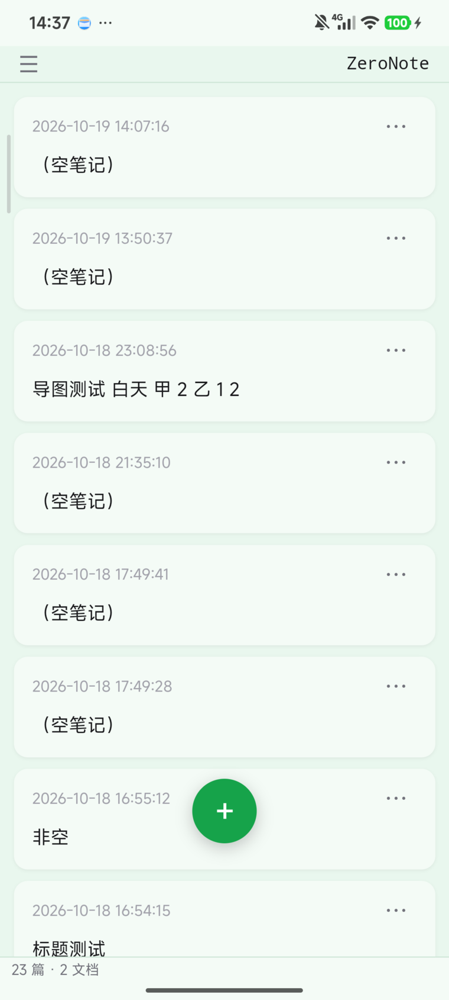

| 位置 | 是什么 |
|---|---|
| 顶部 ☰ | 打开左边抽屉（笔记库 / 文件夹 / 回收站） |
| 顶部中间 | 软件名「ZeroNote」 |
| 中间一叠卡片 | 你的笔记，**最新的在最上面**。每张写：修改时间 + 正文前几行 |
| 底部绿色 ＋ | 新建一条笔记 |
| 底部一行小字 | 「23 篇 · 2 文档」——当前库里有多少笔记、多少文件 |

点任意一张卡片 → 打开那篇笔记。

---

## 2 写一条笔记

1. 点底部的绿色 **＋**
2. 第一行就是**标题**（会自动变成文件名），换行后写正文
3. 写完不用保存，停手约 0.8 秒，右上角从「未保存」变成「已保存」

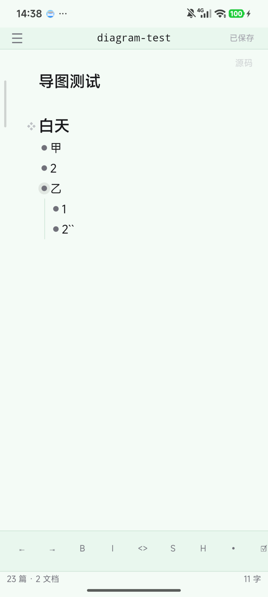

编辑器里能做的事：

| 位置 | 功能 |
|---|---|
| 右上「源码」 | 在「好看的样子」和「Markdown 原文」之间切换 |
| 底部一排 `⇤ ⇥ B I <> S H • ☑` | 缩进 / 取消缩进 / 粗体 / 斜体 / 代码 / 删除线 / 标题 / 列表 / 待办 |
| 左上 ☰ | 打开笔记库抽屉 |

> 底部工具栏是**手机专属**。桌面上没有，桌面用右键菜单。

---

## 3 长按 ＋：快捷入口

**按住绿色 ＋ 半秒**，会弹出一个小半圆，中间是 ＋、上方 5 个圆圈：

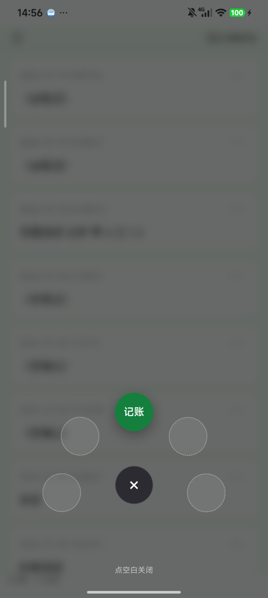

- **短按 ＋** = 新建笔记（和以前一样）
- **长按 ＋** = 打开这圈入口
- 现在只有「记账」是亮的，其余 4 个是空位（以后会接别的功能）
- 点**空白处**或中间的 **×** 关闭

---

## 4 找笔记：抽屉与笔记库

点左上角 **☰** 打开左侧抽屉：

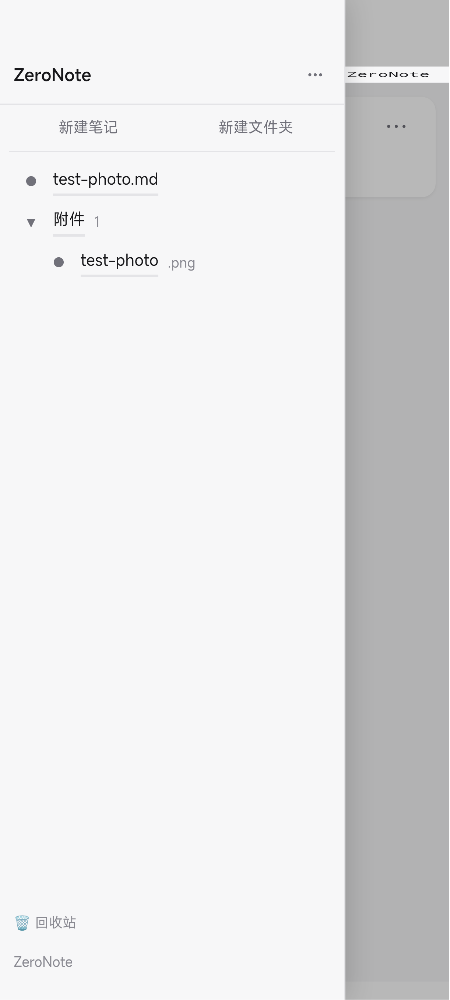

从上到下：

| 区域 | 用途 |
|---|---|
| 顶部齿轮 | 打开设置 |
| 「新建笔记 / 新建文件夹」 | 在当前文件夹里新建 |
| 文件夹列表（笔记 / 工作 / 灵感 / 文档 / 学习） | 点箭头展开收起 |
| 文件列表 | 点一下打开 |
| 文档分组 | PDF / EPUB / TXT 之类的文件，点开直接看 |
| 底部 🗑 回收站 | 看删掉的东西 |
| 最底「ZeroNote」 | 切换笔记库 |

### 换一个笔记库

点抽屉最底部的 **ZeroNote** → 弹出「打开其它文件夹…」：

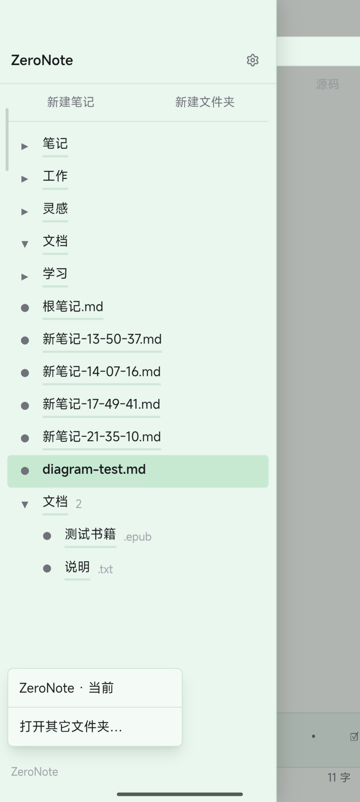

一个文件夹 = 一个笔记库。可以按项目分开放。

---

## 5 改名 / 删除 / 找回

**长按任意一张卡片**（或用卡片右上角的 ⋯）：

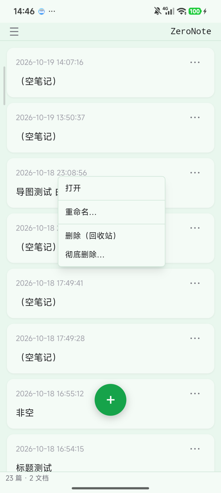

| 菜单项 | 效果 |
|---|---|
| 打开 | 进编辑 |
| 重命名… | 改文件名 |
| 删除（回收站） | 删掉，但**能找回** |
| 彻底删除… | 真删，撤不回来 |

删掉的笔记会进**回收站**（抽屉底部）：

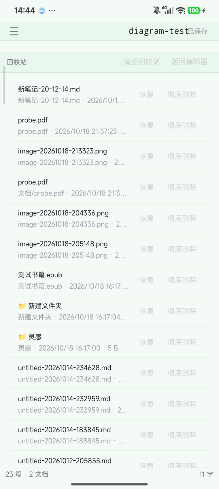

点「恢复」放回去，点「彻底删除」永久抹掉。

---

## 6 编辑区里的更多按钮

在**编辑区空白处按住**（或长按正文区），会弹出这个菜单：

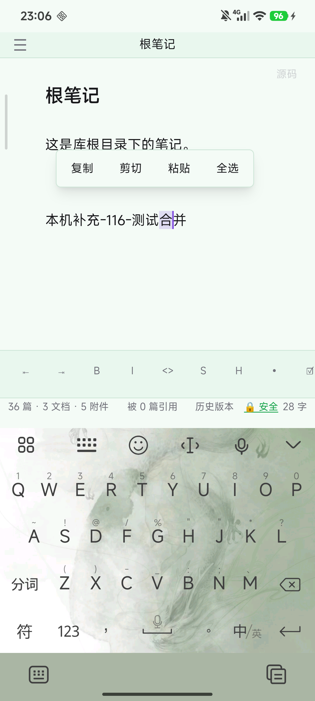

常用的几条：

- **插入附件…**：往笔记里放图片或其他文件
- **查找…**：找正文里的字
- **标记**：一排 Markdown 格式（标题、加粗、清单…），手机上用它比较快
- **设置** / **切换笔记库…**：不用回抽屉也能进

---

## 7 把笔记变成导图

用「# 标题 + 列表」写的内容，可以一键变成思维导图：

1. 打开笔记，点左边那个 **❖**（在第一个小标题左边）
2. 整屏变成导图，可以缩放、拖动
3. 右下角「释放接管」回到普通编辑

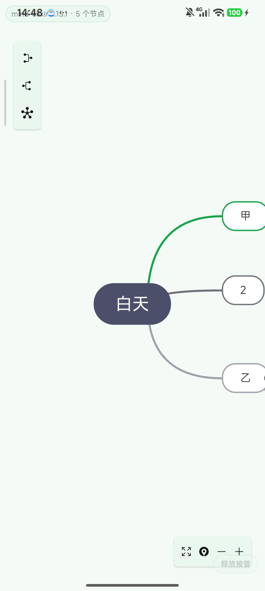

> 导图会读你笔记里的大小标题和列表层级。层级越清楚，导图越好看。

---

## 8 记账

**长按 ＋ → 点「记账」**：

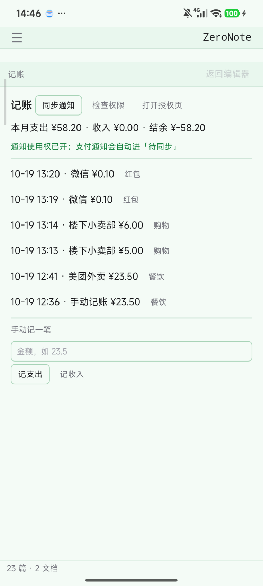

| 区域 | 用途 |
|---|---|
| 顶部「同步通知」 | 把手机通知里的支付记录抓进来（微信 / 支付宝） |
| 「检查权限」/「打开授权页」 | 第一次用要开「通知使用权」 |
| 本月支出 / 收入 / 结余 | 自动算好 |
| 列表 | 每一笔：时间 · 商户 · 金额 · 分类 |
| 点分类名 | 改成别的分类（下次同商户自动记住） |
| 底部「手动记一笔」 | 填金额 → 记支出 / 记收入 |

---

## 9 设置

抽屉顶部齿轮 → 设置：

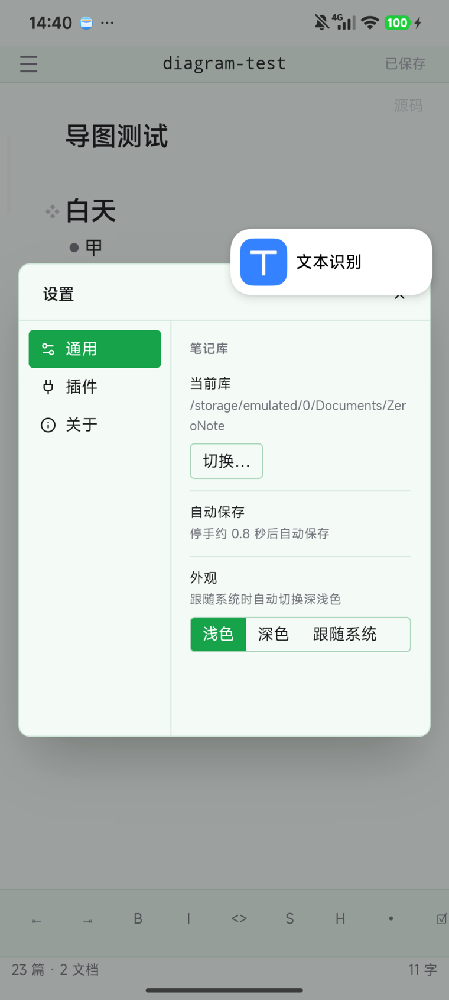

| 标签 | 内容 |
|---|---|
| 通用 | 当前库（可「切换…」）、自动保存（停手 0.8 秒）、外观（浅色 / 深色 / 跟随系统） |
| 插件 | 见下一节 |
| 关于 | 版本信息 |

### 插件

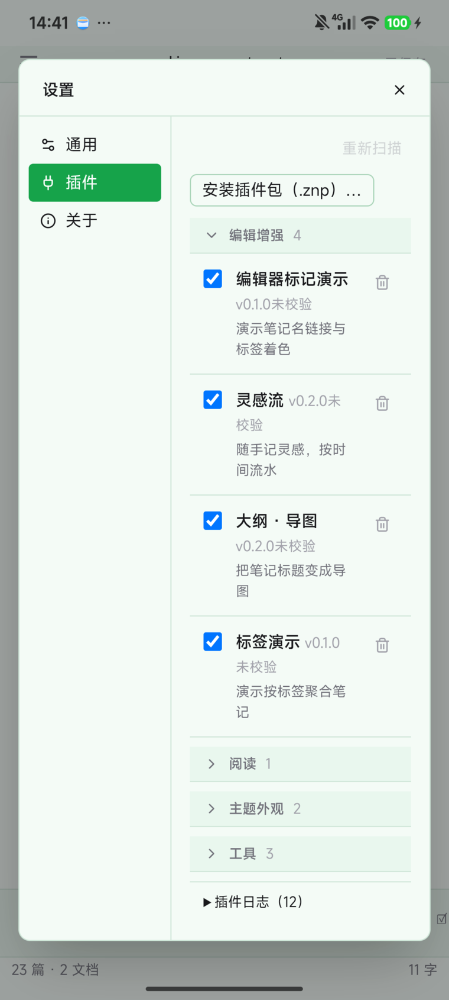

- 每个插件前面有勾选框：**打勾 = 开启**，取消 = 关掉
- 右边垃圾桶 = 删掉这个插件
- 顶部「安装插件包（.znp）…」= 装新的插件
- 已装的按用途分组：编辑增强 / 阅读 / 主题外观 / 工具

**预装的 5 个**：大纲·导图、文档阅读器、导入导出、米色主题、记账。

---

## 10 手势与返回键

| 操作 | 效果 |
|---|---|
| 从左边缘往右划 | 打开笔记库抽屉 |
| 往左划 | 关闭抽屉 |
| 屏幕最底下往上划 | 系统手势（回桌面等），App 不拦 |
| 返回键 | **从最上面一层开始关**：先关遮罩 / 菜单 → 再关笔记 → 最后才退出 App |

> 正在打字时从左往右划**不会**打开抽屉（防止误触）。

---

## 11 常见问题

**问：打开是白屏？**
在最近任务里把它划掉，重开一次。还不行就卸载重装 —— **笔记不会丢**，它们在你手机文件夹里，不在 App 里面。

**问：笔记存在哪？能拷出来吗？**
`内部存储/Documents/ZeroNote/`。用数据线接电脑，把整个文件夹拷走就是完整备份。

**问：换手机怎么搬？**
把 `Documents/ZeroNote` 整个拷到新手机同一位置，打开 App 选这个文件夹即可。

**问：不小心删了怎么办？**
抽屉底部「回收站」→ 找到那一条 → 「恢复」。

**问：为什么有的笔记是「（空笔记）」？**
新建了但没写字。点开写点东西，或者长按删掉。

**问：深色模式在哪？**
设置 → 通用 → 外观，选「深色」或「跟随系统」。

---

## 附：功能入口速查

| 想做什么 | 怎么点 |
|---|---|
| 新建笔记 | 底部 ＋ 短按 |
| 快捷入口 | 底部 ＋ 长按半秒 |
| 打开笔记库 / 文件 | 左上 ☰ |
| 切笔记库 | ☰ → 底部库名 |
| 改笔记名 | 长按卡片 → 重命名… |
| 删笔记 | 长按卡片 → 删除（回收站） |
| 找回删掉的 | ☰ → 回收站 |
| 设置 | ☰ → 齿轮 |
| 装插件 | 设置 → 插件 → 安装插件包 |
| 导图 | 编辑器里点 ❖ |
| 记账 | 长按 ＋ → 记账 |
| 找正文里的字 | 长按编辑区 → 查找… |
| 插图片 | 长按编辑区 → 插入附件… |
